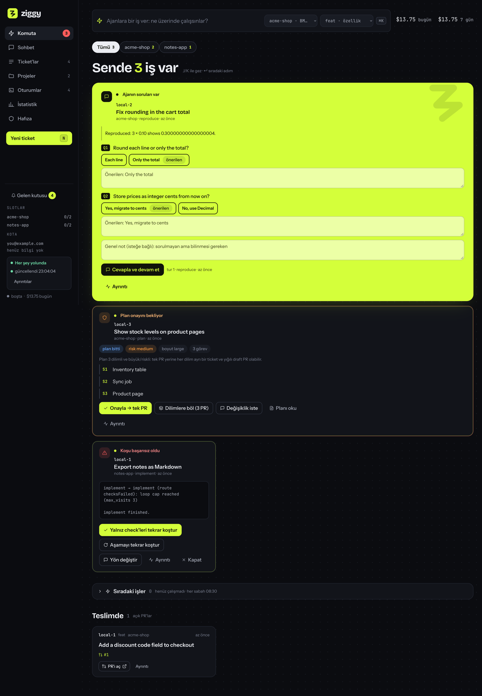
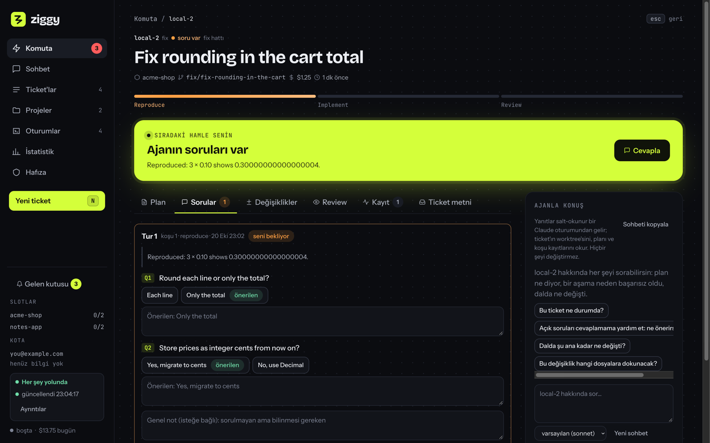
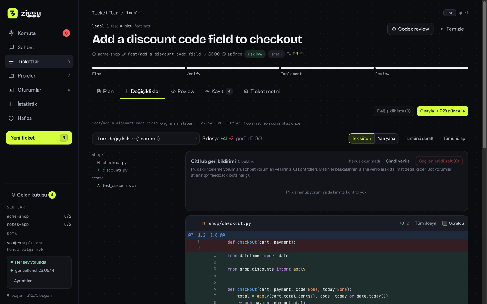
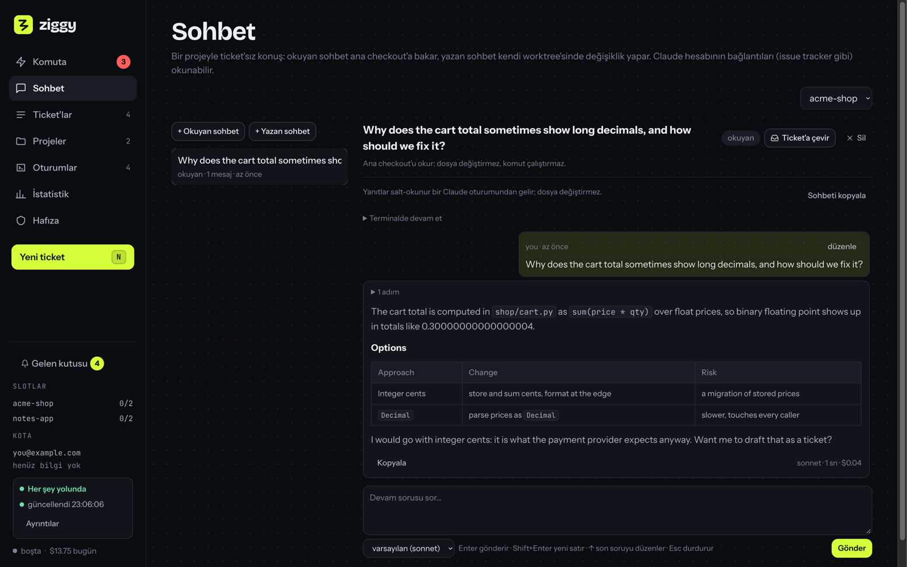
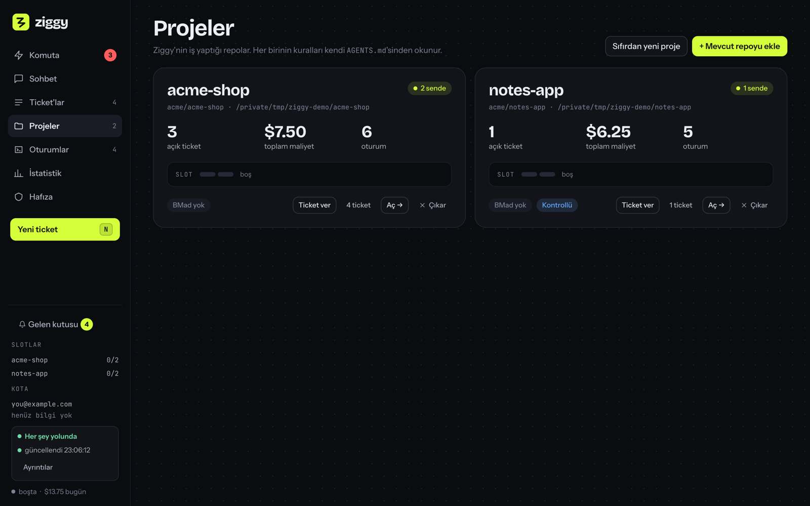
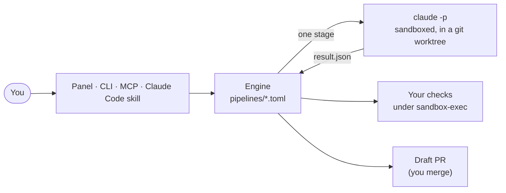

# Ziggy

**A personal agent that turns tickets into reviewed branches, by running headless Claude Code in a sandbox, stage by
stage, while you do something else.**

You write a ticket (in a web panel, the terminal, or from a Claude Code session). Ziggy runs it through a fixed
pipeline (plan → verify → implement ⇄ review), each stage a fresh, sandboxed `claude -p` session in a git worktree of
your repository. It asks when it needs you, stops at an approval gate when a plan is risky, runs your test commands
itself, and ends with a branch of local commits you review and publish as a draft PR. You approve and merge; Ziggy
never does.



## Why

Coding agents are good at a well-scoped task and bad at knowing when to stop, ask, or prove their work. Ziggy keeps
the agent to one stage at a time and puts a deterministic engine around it:

- **The engine decides, not the agent.** Each stage writes a JSON result (`READY`, `NEEDS_USER`, `FAILED`, a route);
  `pipelines/*.toml` says where that goes. Visit caps stop loops; a missing result is a failure, never a pass.
- **Questions and an approval gate.** An agent that needs a decision asks a question round and waits. A plan rated
  risky or large stops for you to approve, change, or split into stacked slices (one draft PR each).
- **Proof, not claims.** After an implement stage says READY, Ziggy runs your checks itself under `sandbox-exec`; a
  failure goes back to the implementer, a broken environment stops the ticket and says what to fix.
- **Sandboxed by default.** No network, no push, no package installs, no MCP, no reading your home folders; writes only
  in the worktree. Draft PRs only.
- **It learns.** Answered questions and review lessons become project memory (markdown you approve) that later stages
  read; a morning "lead" proposes the next tickets from your roadmap, red CI and deferred findings.

## What it looks like

| | |
|---|---|
|  |  |
| A ticket asking a question round, with options and a recommendation | Reviewing the branch before the draft PR |
|  |  |
| Sohbet: talk to Claude about a project, outside any ticket | Projects, their run slots and cost |

The panel's interface is in Turkish (it was built for daily use by its author); the CLI, the code, the prompts and the
docs are in English, and agents answer in the language you pick per ticket.

## Features

- **Pipelines per ticket type** (`feat`, `fix`, `chore`, `project`, stacked `slice`s, optional BMad), each stage with its
  own model, prompt, persona, time limit and tool deny list.
- **Web panel** (`ziggy ui`, local only): a board of what waits on you, live agent activity, question rounds and the
  approval gate, a review page with the diff, PR drafting, cost and quota, project memory, roadmap.
- **Steering**: nudge a running stage with a message, stop it, resume a crashed session, retry a stage, or re-run only
  the checks after fixing an environment.
- **GitHub loop**: draft PRs, PR comments and failing CI brought back as a new round, merged PRs archived and their
  worktrees cleaned.
- **Sohbet**: free chats about a project, read-only or in a worktree of their own, with your Claude login's connectors
  (e.g. an issue tracker) available read-only.
- **MCP server** (`ziggy mcp`): drive Ziggy from any Claude Code or Claude Desktop session ("make this a ticket").
- **Guided onboarding** of a repository: detects how to install and test it (Python, Node, Go, Rust, Swift/Xcode),
  verifies that in a throwaway clone, and proposes its config.
- **Machine-aware**: waits for a Claude login's usage window to reset, and for memory pressure to ease, instead of
  failing.

## Architecture



[docs/architecture.md](docs/architecture.md) draws the whole system: a stage end to end, ticket states, routing, the
safety layers, Sohbet and MCP, and where state lives.

## Quick start

Requirements: **macOS** (the sandboxes and launchd), **Python 3.12** (standard library only), **Claude Code** logged
in, **git**, and **gh** logged in to the account that opens PRs. Optional: `codex` for a second review, `uv` for the
tests.

```bash
git clone https://github.com/ilkeryasin8/ziggy-agent.git ~/src/ziggy
cd ~/src/ziggy
bin/ziggy target add ~/src/your-repo --verify   # look at the repo, try its install and tests, write its config
bin/ziggy ui --install                          # the panel at http://127.0.0.1:8787, kept running by launchd
bin/ziggy new "feat: add a dark mode toggle" --run
```

Or open the panel and use "Mevcut repoyu ekle" (add an existing repository) and the command bar.

Ziggy's own state lives in `~/.local/state/ziggy/` and its config in `~/.config/ziggy/config.toml`
([config.example.toml](config.example.toml) documents every key). Nothing is committed to your repository except the
work a ticket asks for.

## Documentation

- [docs/architecture.md](docs/architecture.md): the picture, with diagrams.
- [docs/reference.md](docs/reference.md): every command and feature.
- [docs/how-it-works.md](docs/how-it-works.md): the rules behind each part, in depth.
- [pipelines/README.md](pipelines/README.md): the pipeline file format and the prompts.

## Status

A personal tool in daily use by its author on macOS, open-sourced as is. Expect sharp edges outside that setup
(Linux would need another sandbox for engine checks). Issues and ideas are welcome.

## Credits

The role personas and review lenses under `prompts/roles/` and `prompts/lenses/` are adapted from
[BMAD-METHOD](https://github.com/bmad-code-org/BMAD-METHOD) (MIT). See [THIRD_PARTY_NOTICES.md](THIRD_PARTY_NOTICES.md).

## License

[MIT](LICENSE)
