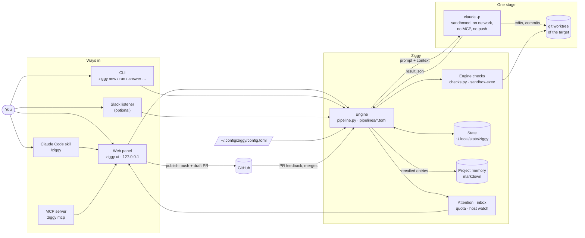
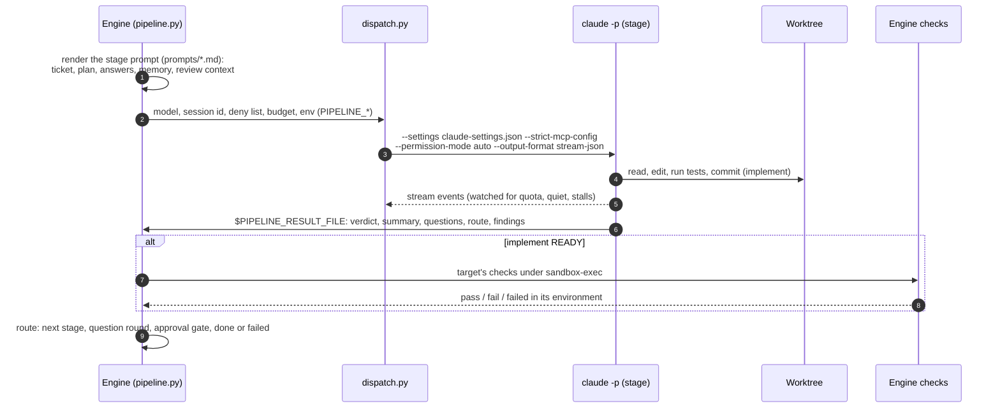
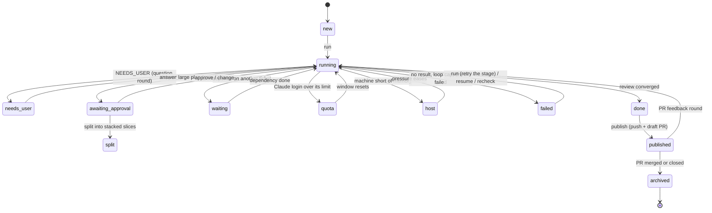
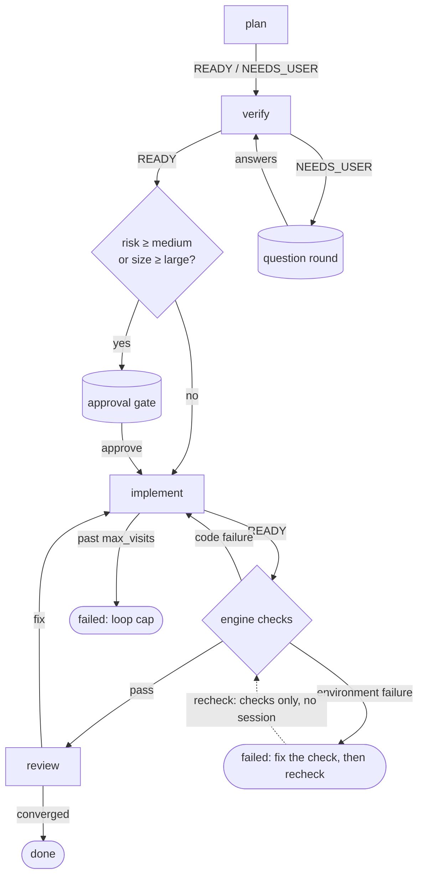
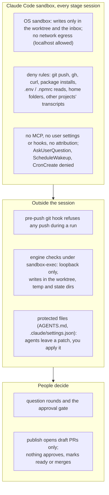
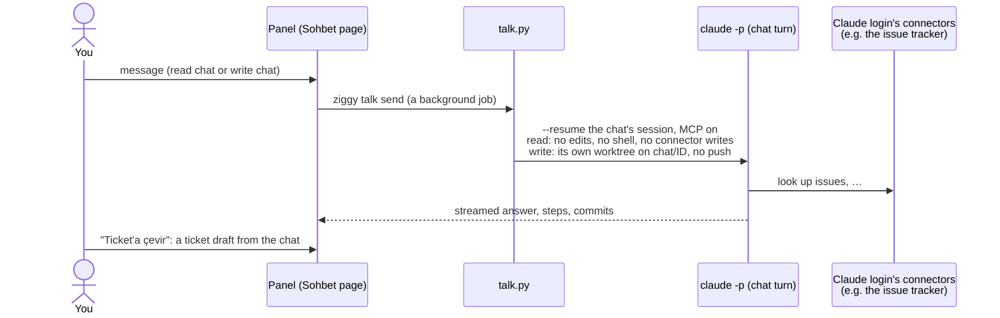
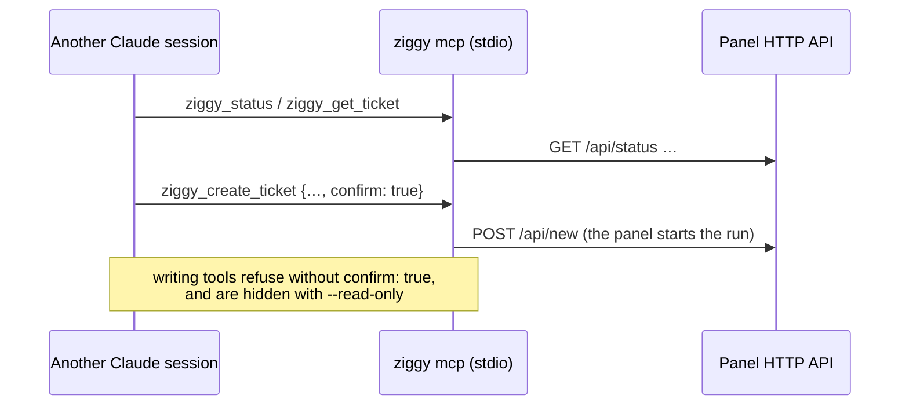

# Architecture

Ziggy turns a ticket into a reviewed branch by running a fixed pipeline of headless Claude Code sessions, one per
stage, each sandboxed in a git worktree of the target repository. The orchestration is a deterministic engine
(`ziggy/pipeline.py`), not an agent: agents only do the work of one stage and report through a result file; the engine
decides what happens next. This page draws the main pieces; [how-it-works.md](how-it-works.md) has every rule and
`ziggy/*.py` the rest (each module starts with a docstring that says what it owns).

## The system



Everything a person does goes through the panel, the CLI or something that drives them (the MCP server and the skill
call the panel's HTTP API; the panel starts the same `ziggy` commands the CLI runs, as background jobs). Only the
engine (and `publish`) touches the target repository from outside a sandbox.

## One stage, end to end



A stage that writes no valid result fails; there is no silent pass. Plan, verify, reproduce and review stages must not
change the repository (their changes are stashed and the stage fails). Each stage has a visit cap per run.

## Ticket states



## Routing: the `feat` pipeline

Pipelines are TOML files (`pipelines/`): an ordered list of stages whose results route to the next. `feat` is the
default; `fix`, `chore`, `project`, `slice` and the optional `bmad` follow the same shape.



## Safety layers



## Sohbet and the MCP server

Two ways to talk to Claude about a project outside a ticket run.





## Where state lives

```text
~/.config/ziggy/config.toml          targets, checks, models, sources … (unknown keys refused)
~/.local/state/ziggy/
  <target>/
    runs/<ticket>/
      ticket.json, ticket.md         the ticket (trusted header, untrusted body)
      state.json                     status, run, rounds, gate, checks
      inbox/                         plan.md, answers.md, deferred.md, artifacts/ (the agents' scratch)
      NN-<stage>/                    one dir per stage visit: prompt.md, claude.jsonl, run.json, checks.log
      chat/                          the ticket's chat turns
    worktrees/<ticket>/              the ticket's git worktree
    talk/<id>/                       Sohbet chats (and a write chat's worktree)
    memory/ (or a notes vault)       project memory, markdown
  attention.json, quota.json, …      the inbox ledger and machine-wide state
```
