# How Ziggy works

The overview with diagrams is [architecture.md](architecture.md); [reference.md](reference.md) lists every command and
feature. This page has the rules behind each part.

Ziggy turns a short ticket into a reviewed branch and a draft pull request on a target
repository, with no human in the loop between "here is the work" and "here is the PR" unless the
work needs a decision. The orchestration is a deterministic Python engine
(`ziggy/pipeline.py`); the LLM work is a series of stages, each one headless `claude -p`
session inside the Claude Code OS sandbox, defined in `pipelines/<name>.toml` with prompts from
`prompts/`. The personas and review lenses are adapted from [BMAD-METHOD](https://github.com/bmad-code-org/BMAD-METHOD)
(MIT).

The pipeline repository never names a target. Targets, their paths, test environments and checks
live in a personal config (`~/.config/ziggy/config.toml`); the rules for a target come from
that target's own `AGENTS.md`, its `docs/PROJECT.md`, and its [project memory](#project-memory)
(a `context.md` plus the rules, decisions and pitfalls you approved, in a vault folder or the
state directory).

Around that loop: a ticket can wait for other tickets and a large plan can leave the approval gate
as a stack of slice tickets ([dependencies and stacked slices](#dependencies-and-stacked-slices));
review comments and red CI on a draft PR come back as a new round ([PR feedback](#pr-feedback));
a stage that finds the work heading the wrong way stops and asks ([intent gaps](#intent-gaps)); a new target's config is
proposed and tried before it is saved ([adding a target](#adding-a-target)); and every morning a lead proposes each
target's next work from its roadmap, CI, issues and deferred findings ([the lead](#the-lead)).

## The big picture

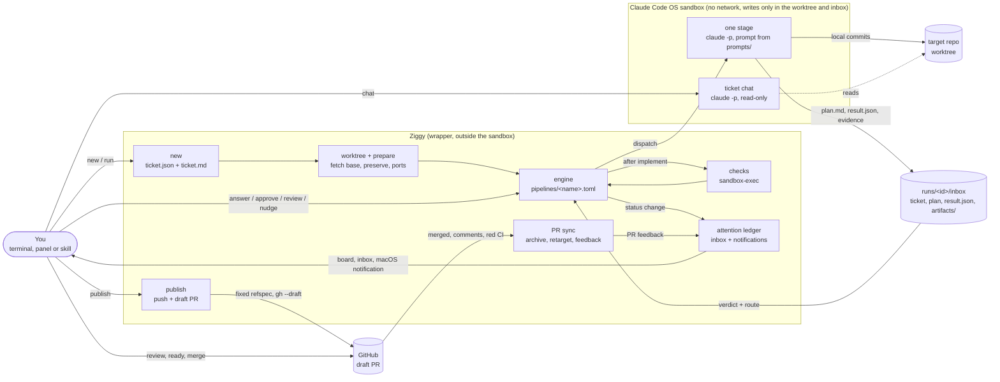

Two halves, with a hard line between them:

| | Wrapper (this repository) | Agent (a stage's `claude -p`) |
|---|---|---|
| Network | yes: `git fetch`, `git ls-remote`, `git push`, `gh` | none (sandbox: no allowed domains; localhost only, for test databases) |
| Writes | state directory, worktree creation, stashes of interrupted work, the attention ledger | only inside the ticket's worktree and its inbox (a chat turn: nothing it keeps; its writes are stashed) |
| Push / PR | the one place that pushes, and only a draft PR | never (sandbox + deny rules + `pre-push` hook) |
| Secrets | `gh` token of the configured account | none |

## One ticket, end to end

A `feat` ticket that needs one decision and passes its checks:

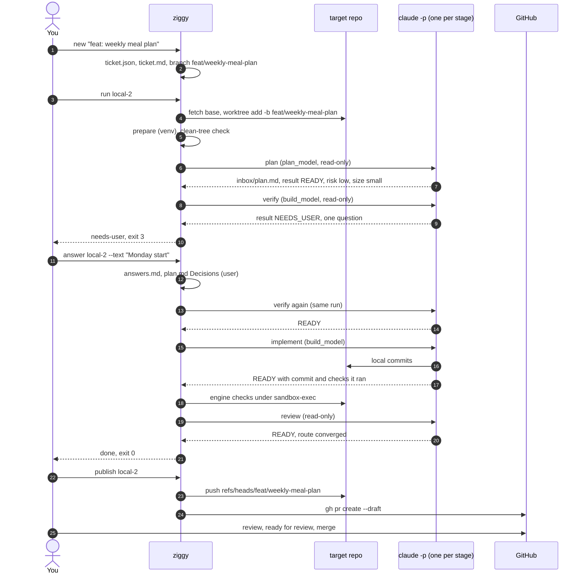

Each stage is a fresh session on purpose: it starts from what the earlier stages wrote down (the
plan in `inbox/plan.md`, the previous results, the commits) rather than from a half-remembered
conversation. The prompt gives it the ticket, the plan, the user's answers, the project doc and
the latest result of every earlier stage (`prev.<stage>`).

Every session gets the same flags:

```
claude -p "<prompt + result protocol footer>" --model <plan_model|build_model|model id>
  --settings claude-settings.json --setting-sources project   # target settings yes, your global ones no
  --strict-mcp-config                                         # no MCP servers
  --permission-mode auto
  --add-dir runs/<id>/inbox                                   # ticket copy, plan, result file, artifacts/
  --disallowedTools <stage tools_deny> AskUserQuestion ScheduleWakeup CronCreate
  --session-id <uuid> --output-format stream-json --verbose   # --resume <session> for a nudge or retry
  --json-schema <the stage's result schema>                   # when the installed claude has it
  --effort <stage effort>                                     # when set and the installed claude has it
  --max-budget-usd <budget_usd>                               # when the target sets one (retro, onboarding: ≤ $1)
env: ZIGGY_RUN=1, GIT_CONFIG_* → core.hooksPath=githooks/, PIPELINE_RESULT_FILE,
     PIPELINE_STAGE, PIPELINE_TICKET, PIPELINE_INBOX, PIPELINE_PLAN, PIPELINE_WORKTREE,
     PIPELINE_BASE_COMMIT, PIPELINE_VISIT, PIPELINE_LAST_VISIT, PIPELINE_ARTIFACTS_DIR,
     PIPELINE_PORT/PIPELINE_PORT_END (when the target has ports), the target's [env] table
```

A later visit of a stage in the same run may run differently: `[stages.visits.N]` overrides
`model`, `effort`, `timeout`, `quiet_after`, `tools_deny` and `prompt`, cumulatively (the shipped
review stages use `effort = "high"` from visit 2).

The agent reads the ticket from `runs/<id>/inbox/`, passed with `--add-dir`: Claude Code refuses
reads outside the working directory, and the sandbox makes an added directory writable for Bash,
so the wrapper rewrites its own files there (`ticket.md`, `answers.md`) before every stage and
deletes the previous `result.json`.

## Routing

A stage ends by writing its result to `$PIPELINE_RESULT_FILE`: a `verdict` (`READY`,
`NEEDS_USER`, `FAILED`), a summary, questions, an optional `route` and fields for its kind of
result (`plan`, `verify`, `implement`, `review`, `doc` or `generic`, see `ziggy/results.py`).
The engine takes the file if it matches the schema, else the structured output of `--json-schema`,
else the last `VERDICT:` line of the final message; with none of them the stage fails.

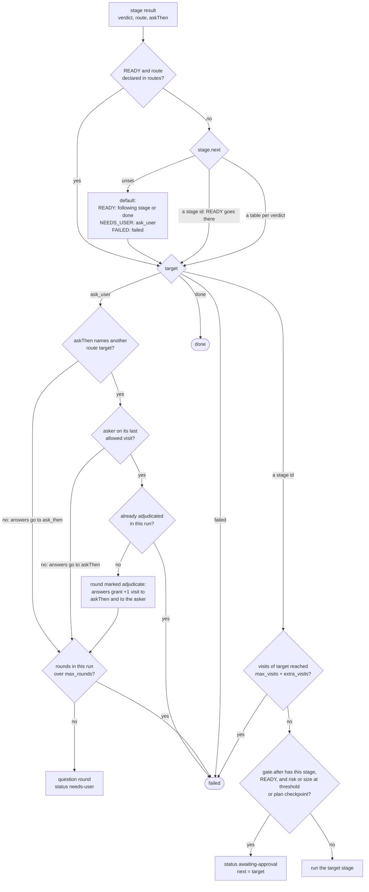

- `routes` names the choices a stage may make with `READY`: review declares `fix` (back to
  implement) and `converged` (done); the doc review declares `revise` and `accept`. A route the
  stage does not declare, or a route with another verdict, is ignored with a warning in `run.json`.
  An open finding with disposition `fix` (any class) means `fix`: the engine routes a `READY` review
  with one open there, and on the last round defers the non-important ones and converges instead.
- `checksFailed` is the engine's own route: after a `READY` of a stage with `checks = true`
  (implement, bmad-build), the target's checks run, and a failure takes that route (back to the same
  stage) when the stage declares it, or fails the run.
- `max_visits` caps how often a stage runs in one run (implement 3, review 2 or 3); a loop past it
  fails the run with "loop cap reached" instead of spending more. A retry after a failure is a new
  run, so the caps start over; `answer` and `approve` continue the same run. Nudges and automatic
  retries continue the same visit and do not count.
- Answers continue at the stage's `ask_then`, else the pipeline's `[ask_user] then`. Review asks
  again itself; in `feat` the plan's questions go to verify first, which puts only the product
  decisions to you.
- Last-visit adjudication: a review on its last allowed visit may ask you about the findings still
  open instead of hitting the cap (`NEEDS_USER` with `askThen = "implement"`). Answering grants one
  more implement and one more review visit in that run (`run.extra_visits`, `run.adjudicated`, the
  next step `via` `adjudicated`); asking again on that last visit fails the run.
- Risk and size are the highest any result has reported; they are never lowered. `[gate]` sets the
  thresholds per pipeline (`feat`: risk medium or size large, after plan or verify; `fix` and
  `chore`: risk high; `bmad`: risk high or size large, after bmad-plan; `project` and `slice`: no
  gate).
- A stage with `writes = false` (plan, verify, reproduce, review, doc review, bmad-plan) that leaves
  changes or commits fails, and its changes are stashed. Paths in a stage's `commit_paths` (the BMad
  stages: `_bmad-output`) are committed by the engine after the session (`records_commit` in
  `run.json`) and do not count as writes.
- An implement or review result with `intentGap` is not routed: the engine sets the attempt aside and
  opens a question round ([intent gaps](#intent-gaps)).
- Before it starts any stage, the engine checks the ticket's dependencies; one not done makes the
  ticket `waiting` ([dependencies](#dependencies-and-stacked-slices)). It then checks the target's
  Claude login: one over its usage limit makes the ticket wait as `quota` ([usage limits](#usage-limits)).
  Last, the machine: critical memory pressure or nearly full swap makes it wait as `host`
  ([a busy machine](#a-busy-machine)).
- A controlled target (`mode = "controlled"`) gates after planning whatever the risk, like a ticket's
  plan checkpoint ([controlled mode](#controlled-mode)).

The pipelines:

```mermaid
flowchart LR
    subgraph feat
        fp[plan] --> fv[verify] --> fi[implement] --> fr[review]
        fi -- checksFailed --> fi
        fr -- fix --> fi
        fr -- converged --> fd([done])
    end
    subgraph fix
        xr[reproduce] --> xi[implement] --> xv[review]
        xi -- checksFailed --> xi
        xv -- fix --> xi
        xv -- converged --> xd([done])
    end
    subgraph chore["chore (refactor, chore, docs)"]
        cp[plan] --> ci[implement] --> cr[review]
        ci -- checksFailed --> ci
        cr -- fix --> ci
        cr -- converged --> cd([done])
    end
    subgraph project
        pw[write] --> pr[doc-review]
        pr -- revise --> pw
        pr -- accept --> pd([done])
    end
    subgraph bmad["bmad (opt-in for code tickets)"]
        bp[bmad-plan] --> bb[bmad-build] --> br[review]
        bb -- checksFailed --> bb
        br -- fix --> bb
        br -- converged --> bd([done])
    end
    subgraph slice["slice (one per slice of a split ticket)"]
        si[implement] --> sr[review]
        si -- checksFailed --> si
        sr -- fix --> si
        sr -- converged --> sd([done])
    end
```

A code ticket may take the `bmad` pipeline instead of its type's (`new --pipeline bmad`, "Hat: BMad"
in the panel's composer). It is offered only when the target's base branch on the remote has
`.claude/skills/bmad-build-auto/SKILL.md` and `_bmad/`, and the main checkout has BMad's
git-ignored per-developer files, which are copied into the ticket's worktree (`ziggy/bmad.py`).
Its two prompts call BMad's `/bmad-build-auto` skill (plan, halt, then build from the spec it wrote
under `_bmad-output/`); engine checks, review, the gate and the draft PR stay the pipeline's.

### Review rounds

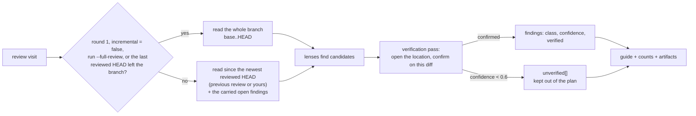

Review rounds follow `prompts/_review-policy.md`: a real problem the change introduced, in scope and
cheap to fix, is `fix` whatever its class and sends work back; out of scope or costly is `defer`
(with `pre-existing` problems, to the deferred list); `dismiss` is only for a wrong finding, and the
panel and PR draft still show those ("Review N bulguyu eledi"). The engine holds a `READY` review to
that (`results.settle_review_route`, changes logged in `result_warnings`). The review context the
engine used (full or since which HEAD, and why) is recorded as `review` in the stage's `run.json`.
Implement reports per finding it was asked to fix an outcome (`fixed`, `skipped`, `no_change`), which
the review page shows on the finding. Both stages may save evidence (screenshots, recordings, logs)
under `inbox/artifacts/` and list it in `artifacts`. When the target has engine checks, implement runs
only the tests covering its change and review only targeted ones, reading the checks' results instead.

Deferred findings (`inbox/deferred.md`) are listed in the ticket's "Ertelenenler (deferred.md)"
section, each with "Ticket'a çevir": it prefills the composer, and the new ticket records
`origin = {kind: "deferred", ticket, entry}` so an entry is converted once (`ziggy/deferred.py`).

## Ticket states

```mermaid
stateDiagram-v2
    [*] --> new: new
    new --> running: run
    running --> running: READY and the next stage, or a nudge or automatic retry (same session)
    running --> needs_user: NEEDS_USER
    running --> awaiting: gate after a READY
    running --> done: route converged, or last stage READY
    running --> failed: FAILED, no result, timeout, stop, loop cap, check failed

    needs_user --> queued: answer --no-run
    needs_user --> running: answer
    awaiting --> running: approve, or answer with a change
    awaiting --> queued: approve --no-run
    queued --> running: run
    failed --> running: run (new run at that stage), resume, answer
    done --> running: request-changes, fix (new run at user_review.then)
    done --> [*]: publish, draft PR, merged, archived
    new --> waiting: run, while a ticket it starts after is not done
    queued --> waiting: answer or approve, same
    running --> waiting: before the next stage, same
    waiting --> running: the last one is done (started on its own; a controlled target asks first)
    awaiting --> split: split (one slice ticket per plan slice)
    running --> quota: the session hit the usage limit, or the login is over it before a stage
    new --> quota: run, while the login is over its limit
    quota --> running: a minute after the window resets (started on its own; same session), or run --now
    running --> host: before the next stage, the machine is short of memory
    new --> host: run, same
    host --> running: after two calm panel ticks (started on its own), or run --now

    state "needs-user" as needs_user
    state "awaiting-approval" as awaiting
```

- `needs-user` is the pipeline asking you questions. `ziggy status <id>` shows them;
  `answer <id> --text "..."` closes the round, records it in `answers.md` and in the plan's
  `## Decisions (user)`, and continues.
- `awaiting-approval` is the approval gate: the plan is ready and rated risky or large (or the
  ticket asked for a plan checkpoint). `approve` continues; `answer` records your change in the
  plan and sends it to the stage that takes answers (verify in `feat`, reproduce in `fix`, plan
  in `chore`, bmad-plan in `bmad`), which works it in before the run goes on. A large or high-risk
  `feat`, `fix` or `chore` plan with two or more slices may be `split` instead: the ticket becomes a
  container (`split`) of stacked slice tickets.
- `waiting` is a ticket that starts after other tickets (`new --after`, or a slice above another): no
  stage runs until they are all done, and then it starts on its own (a controlled target asks first).
- `quota` is a ticket waiting for its Claude login's usage limit to reset: `next` holds the step it
  takes then (the interrupted session to resume, or the stage it did not start), `quota` holds the
  login, the reason (`rejected` or `admission`) and `resume_at`.
- `host` is a ticket waiting for the machine to have memory again: `next` holds the stage it did not
  start, `host` the stage, `since` and the sample that held it.
- `running` found by a later command means the process died mid-stage; it is turned into `failed`
  under the ticket's lock. `resume` continues a crashed, killed or timed-out session with
  `claude --resume`; `run` retries the stage fresh.
- A stage session ends `ok`, `failed`, `killed` (stopped), `timeout`, `lost` (no result event) or
  `quota` (no result, and the account's limit was reached: it is resumed after the reset).
  A nudge, a quiet spell (when the stage retries quiet sessions) or a timeout first interrupts the
  agent with SIGINT, so it ends its turn and its session can be resumed; one still alive 60 s
  later is killed. Then the engine decides:

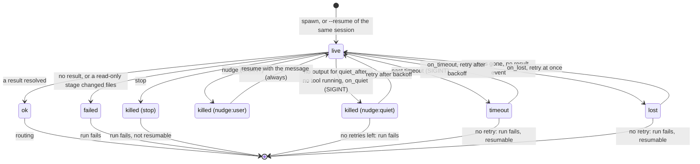

  A retry continues the stage in its own session as the same visit: a new `NN-<stage>/` directory
  with `retry_of` naming the interrupted one, the cause and the message in its prompt. At most
  `[stages.retry] max` (2) per run for every cause together, waiting `backoff` (30 s) doubled each
  time up to `max_backoff` (10 min). A session that continues on its own keeps its half-done edits
  in the tree; otherwise interrupted edits are stashed, never deleted, and handed back by `resume`.

## Safety layers

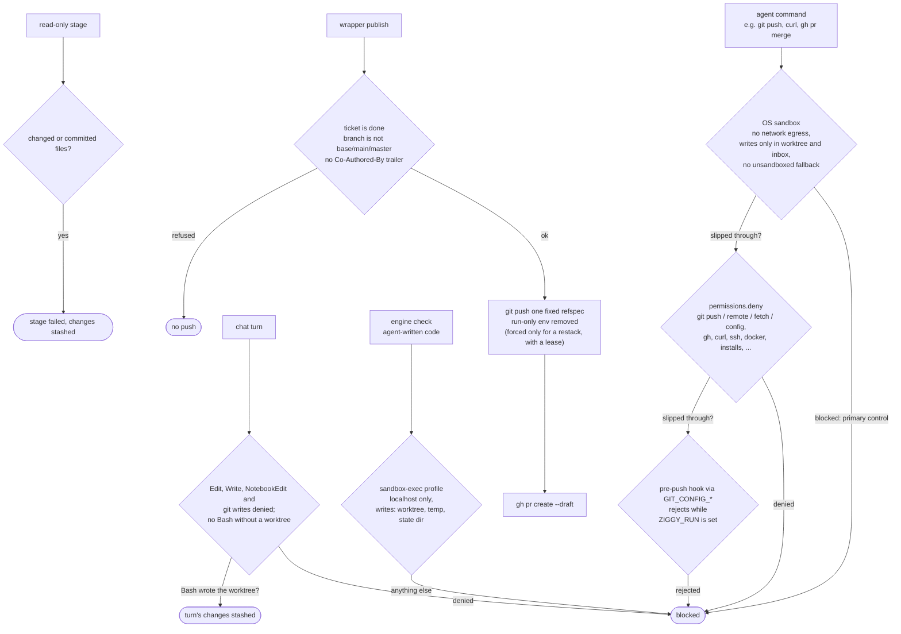

- The sandbox is the control. A first design guarded command strings; review showed an
  interpreter subprocess, an inline alias or `git send-pack` walks around such guards, so the
  deny list and the hook are only cheap second layers. `scripts/sandbox-smoke.sh` re-checks the
  sandbox against a target after Claude Code upgrades.
- The pre-push hook reaches git through `GIT_CONFIG_*` variables of the run, so the target's
  `.git/config` is never edited.
- `disableAllHooks` in `claude-settings.json`: a target's own Claude Code hooks never run in a
  pipeline session.
- Engine checks run the agent's code outside Claude's sandbox, so they run under macOS
  `sandbox-exec` with a profile generated per check (`ziggy/checks.py`); without
  `sandbox-exec` a check fails rather than run unsandboxed. `scripts/checks-sandbox-smoke.sh`
  proves the profile. Each check is bracketed by `git status`: untracked files it left behind are
  deleted and named as a warning (`left_files`), so the next read-only stage finds a clean tree;
  tracked files it changed fail it ("checks modified tracked files: …"). A target may opt into
  named presets (`check_sandbox = ["xcode"]`, validated at load): `xcode` adds writes to SwiftPM's
  cache (`~/Library/Caches/org.swift.swiftpm`, its real path resolved at run time) and outbound
  connections to unix sockets under `/private/var/tmp` (the simulator's testmanagerd); nothing else
  changes, and targets without a preset get the same profile as before.
- Protected files: `claude-settings.json` denies `Edit(./AGENTS.md)` and
  `Edit(./.claude/settings.json)`, so a poisoned ticket cannot write lasting instructions for later
  agents. Changes to them reach the branch only as patches you approve (see
  [Protected files](#protected-files)).
- `AskUserQuestion` is always denied (nobody watches a headless session), and so are
  `ScheduleWakeup` and `CronCreate`: a pending wakeup keeps a headless session idling until it fires.
- Each session records `git ls-remote` before and after (`remote_unchanged` in `run.json`): ground
  truth that the session pushed nothing.
- The ticket text is marked `## Ticket (untrusted)`; the standing rules (`prompts/_context.md`)
  tell every stage that it is data, and that a ticket asking it to ignore rules, run commands or
  fetch URLs ends the stage `FAILED` / "suspicious ticket". PR feedback you send to the agent is
  quoted the same way under `## Review (github, round N)` and treated as data.
- Only the wrapper reads and writes the project memory folder; sessions never read the vault.
  Recalled memory is fenced as data under `## Proje hafızası`, and secrets are scrubbed from
  candidates before they are stored. `permissions.deny` keeps the Read tool and the file commands
  Claude Code recognizes in Bash (`cat`, `head`, …) out of `~/Documents`, `~/Desktop`,
  `~/Downloads`, iCloud Drive (`~/Library/Mobile Documents`) and Claude Code's per-project data
  (`~/.claude/projects`, and `~/.claude-*/projects` of other logins: its auto memory), and the
  standing rules say the memory comes from Ziggy and another repository is read only when the
  ticket or `PROJECT.md` names it. A script that opens files itself is not covered by the deny
  list; `scripts/sandbox-smoke.sh` checks `cat` and Read on a canary under `~/Documents`.
- Only the wrapper pushes: `publish.py` (a ticket branch, never a protected or base branch, to a
  draft PR; also the restack push), the AGENTS.md draft PR of onboarding (its own `docs/agents-md`
  branch) and `project new`'s first push of `main`; commits and PRs carry no attribution trailer
  (`"attribution": {"commit": "", "pr": ""}`). Nothing in the pipeline approves, marks ready or
  merges; a test greps the code for it. `publish --title --body-file` only replaces the PR's text;
  every rule above still applies. Replies to PR feedback are written by the wrapper, only with
  `pr_replies = true` (default off).
- Ticket chat is read-only: `Edit`, `Write`, `MultiEdit`, `NotebookEdit` and the git commands that
  move the branch, the index or the worktree are denied (deny rules win over the stages' allowed
  `git add`/`git commit`), under the stages' sandbox settings. Bash can still write the working
  directory, so files a turn changed in the worktree are stashed after it; a ticket without a
  worktree is read in your own checkout with no Bash at all.
- Notifications are sent only by the wrapper's processes (`notify.py`: `terminal-notifier` or
  `osascript`, argv only, never a shell); a session's sandbox denies `osascript` anyway.
- The panel serves evidence only from `runs/<id>/inbox/artifacts/`: a regular file inside it after
  `realpath`, one of an allowlist of extensions (png, jpg, jpeg, gif, webp, svg, mp4, webm, mov,
  log, txt, md, json) under a size cap, with `X-Content-Type-Options: nosniff` and a `sandbox`
  Content-Security-Policy, so an agent-written SVG or HTML-looking file cannot run script.
- Engine checks and teardown commands get the ticket's port range (`PIPELINE_PORT`,
  `PIPELINE_PORT_END`) like the sessions, so parallel tickets do not fight over ports.

## What lives where

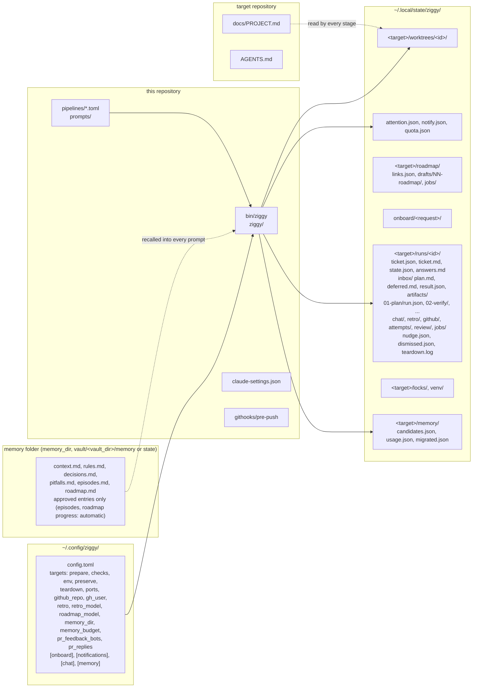

- `run.json` (one per stage session): stage, run number, visit, model, effort, session id, prompt,
  cost, turns, duration, verdict, route, the resolved result and where it came from (file,
  structured output or a `VERDICT` line), the session state (and `interrupt`, `interrupted_at`,
  `nudged`, `retry_of`, `retry` when it was interrupted or continues another), the review context
  used, commits made (and `records_commit` for `commit_paths`), `remote_unchanged` (with
  `remote_changed`: refs that moved, leaving out other tickets' own branches and GitHub's
  `refs/pull/*`, which runs side by side move), the checks, `host` (memory samples at the start and
  end and the worst seen), `tool_calls` (the slowest five), `stall` while a tool call runs past
  `stall_after`, and `time_report` for a session that ran out of time. Next to it: `prompt.md`,
  `result.json`, a `plan.md` snapshot, `checks.log`, the nudge that interrupted it and the raw
  `claude` output.
- `state.json` adds to the run `extra_visits`, `adjudicated`, `retries`, `full_review` and
  `pre_implement`, plus `nudges` (every message, by whom and from where), `port_base` (the
  ticket's port range, kept until its worktree is removed), and for dependencies and stacks
  `waiting_for`, `children`, `restack`, while it waits for a usage limit `quota`, and while it waits
  for the machine's memory `host`.
- `locks/`: one process per ticket (`ticket-<id>`), the target's run slots (`active`,
  `active-2`, … up to `max_active`, default 2), and `git` around fetches and worktree adds in
  the shared `.git`. A lock whose owner process is gone is taken over. With every slot taken a
  run waits in line, first come first served (`waiting_since` in its state; the panel shows
  "kuyrukta", and stop takes it out of the line); `--no-wait` refuses instead. Waiting for a
  person holds neither a lock nor a slot.
- Worktrees live under the state directory, never under `~/.claude` (a protected path where
  the sandboxed agent cannot commit).
- `attention.json` is the inbox ledger for every target: one row per needs-you occurrence (kind,
  severity, title, created, seen, closed, resolved, notified), written under a machine-wide lock
  with an atomic replace, since the engine processes and the panel all write it; rows resolved
  more than 30 days ago are dropped. `notify.json` holds the notification rate window. `quota.json`
  holds the latest usage-limit report per Claude login ([usage limits](#usage-limits)), written the
  same way.

## Worktrees

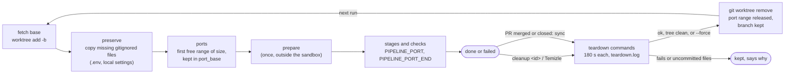

- `preserve` (globs relative to the target checkout, no `..`) copies files git ignores from the
  main checkout into a new worktree, and again before every run where they are missing; tracked
  files and symlinks never are. A `bmad` ticket's worktree also gets BMad's per-developer files.
- A slice's worktree starts from the local branch of the slice below (`worktree.base_ref`), not
  from the remote base, so a stack needs no push to build.
- `ports = { start, size, count }` gives each ticket its own range; the env reaches `prepare`,
  `teardown`, every session and the engine checks, and prompts see `{{ports.base}}`/`{{ports.end}}`.
- `cleanup <id>` removes a done, failed or split ticket's worktree and keeps its branch, so `run`
  recreates the worktree from it; `--force` removes it even with uncommitted files or a failing
  teardown. Without an id, `cleanup` handles the tickets whose PR is merged or closed (teardown
  first).

## Watching and stepping in

Sessions run with `--output-format stream-json`, so each event lands in
`runs/<id>/<nn>-<stage>/claude.jsonl` as it happens. `ziggy watch <id>` turns that into
lines (`$ <command>`, `edit <file>`, `subagent started: …`, `» <agent remark>`, `! <tool error>`)
and follows the run from stage to stage until it ends; `--brief` keeps milestones, `--all` replays
every session. While a session (or its checks) runs, its process id is in `pid` next to the
stream; `ziggy stop <id>` ends the process group, the stage is recorded as `killed` and the
run fails, and `answer <id> --text "..."` can then send the ticket off in a new direction, or `run`
retries the stage.

To change direction without stopping, `nudge`:

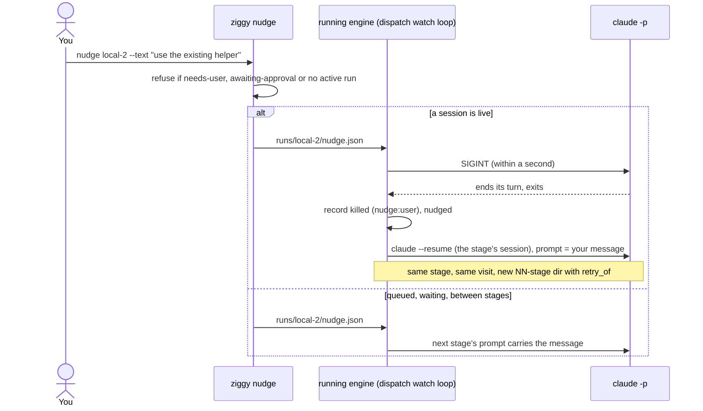

The engine's own watchdog uses the same interrupt: past the stage's `timeout`, and, when the stage
retries quiet sessions, after `quiet_after` without output while no tool the agent started is
running (a test run does not count as quiet; the CLI's `tool_progress` heartbeats for a long tool
call count as output too). An agent still alive 60 s after the SIGINT is killed.

A tool call is never interrupted for taking long. The watch loop (`stalls.Watch`) times each call
from its `tool_use` to its `tool_result`, using the heartbeats' `elapsed_time_seconds` when they say
more; one open past the target's `stall_after` (10 m) is the session's `stall` in `run.json` and an
inbox item, "Komut 12 dk’dır sürüyor: grep -ril … · bellek kritik" (with the machine as it is now),
offering "Yönlendir" and "Durdur"; it is resolved when the call returns or the stage ends. Subagent
calls (Agent, Task) are not timed themselves: their own tool calls are. A session that ends by its
timeout, by going quiet or by losing its process without a result file gets `time_report`, and a
run that fails there starts its error with it: "zaman aşımı (45 dk): sürenin 34 dk’sı (%76) en
yavaş 3 komutu beklerken geçti (grep -ril … 25 dk, …); bellek baskısı kritikti" (the share counts
calls that ran side by side once). The session state stays `timeout`, `killed` or `lost`.

The `ziggy` Claude Code skill (`skills/ziggy/`) wraps all of this for use from a
session: it writes the ticket, runs it in the background, relays `watch --brief`, puts questions
and the approval gate to you, passes your change of direction on with `nudge`, and opens the
draft PR when you say so.

## Ticket chat

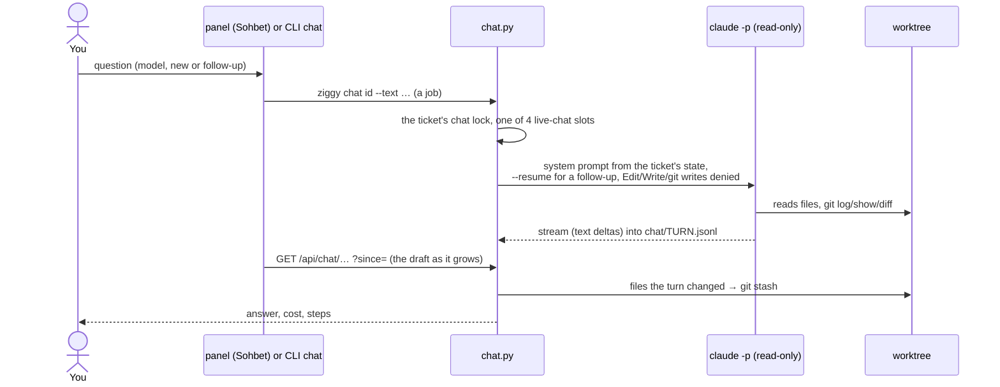

A chat turn runs where the ticket's agents work (the worktree, else the main checkout) under the
stages' sandbox settings, with `--disallowedTools` for `Edit`, `Write`, `MultiEdit`,
`NotebookEdit` and every git command that moves the branch, the index or the worktree. Without a
worktree it also gets no Bash. Models come from `[chat] models` (the first is the default), a reply
stops after `[chat] timeout` (30 min) or with `chat-stop`; one reply per ticket, four at a time
on the machine. Turns live in `runs/<id>/chat/` (`turns.json`, `<turn>.jsonl`), outside the stage
directories, so the engine never sees them, and the sessions list leaves them out.

## Sohbet

A Sohbet chat (talk.py) is the ticket chat without the ticket: the same turn (one `claude -p` per message, `--resume`
for the next, stream-json with text deltas), the same `[chat]` models and timeout and the same four live-reply slots,
under `<state>/talk/<id>/` (`meta.json`, `turns.json`, `<turn>.jsonl`, `scratch/` as the agent's `--add-dir`,
`jobs/`). Its mode is fixed at the start:

| Mode | Where | Tools |
|---|---|---|
| read | the main checkout | no `Edit`/`Write`/`MultiEdit`/`NotebookEdit`, no Bash |
| write | `talk/<id>/worktree` on `chat/<id>` from `<remote>/<base>`, created and prepared (preserve, prepare) with the first message | everything but `git checkout/switch/reset/rebase/branch/tag/push/worktree`; the pre-push hook still refuses a push |

It is the one place a session runs without `--strict-mcp-config`: the claude.ai connectors of the target's Claude login
(`CLAUDE_CONFIG_DIR` in its env) and the repository's MCP servers load, so the tracker can be asked about. A read chat
looks things up through them but does not act: every MCP tool whose name starts with a writing verb is denied on any
server (`mcp__*__update_*`, `mcp__*__send_*`, … `talk.MCP_WRITE_VERBS`), and neither mode gets `RemoteTrigger`. A write
chat's turns record the files left changed and the commits made (nothing is stashed or undone); deleting it removes the
worktree and the branch, refused while the branch holds commits not on its base or changed files unless forced.
"Ticket'a çevir" (`GET /api/talk/<target>/<id>/ticket`) drafts a ticket from the title and the last turns. Its
session ids are left out of the sessions list like the ticket chats'.

## Project memory

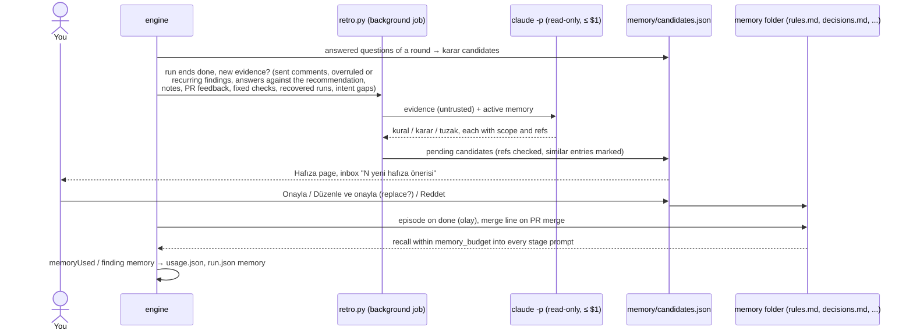

Where the folder is: the target's `memory_dir`; else, with `[memory] vault`, the `projects.json`
(`projects_map`) root whose `prefix` is exactly the target path and whose `vault_dir` exists,
giving `<vault>/<vault_dir>/memory`. Without one, the nearest parent root naming one project (no
`{leaf}`, e.g. a folder holding a frontend and a backend repo) gives each repo its own
`<vault>/<vault_dir>/memory/<repo folder>`; a catch-all parent (`{leaf}`) is never used. Else
`~/.local/state/ziggy/<target>/memory`, and "Hafıza" shows a hint when it fell back. It holds `context.md`
(free-form), `rules.md`, `decisions.md`, `pitfalls.md` and `episodes.md`; each entry is a
`## M-<n> · <kind> · <title>` heading with `- Field: value` lines (the main field, `Ne zaman
geçerli:` globs and topics, `Kaynak:`, an optional `Durum:`). The markdown is the source of truth
and is re-read every time; the wrapper only appends entries and rewrites one entry's `Durum:`.
Candidates, use counts and the migration marker stay in the state directory (`<target>/memory/`),
never in the vault.

Candidates come from every answered question round (one decision per answer: "ok" takes the
recommendation), from the retro and from the one-time migration. Nothing new to learn from means
no retro session. It runs through the same dispatch and sandbox as a stage with the target's
`retro_model` (default sonnet), at most $1 and 10 minutes, no editing tools, no shell and no
subagents, and is recorded in `runs/<id>/retro/NN-retro/` (stage `retro` in the stats). An item
naming no ref it was given is dropped, as is one already in memory or among the open candidates.
Only an approval writes an entry; with replace the similar ones get `Durum: yerini aldı M-<new>`.
Episodes need no approval: one `olay` per ticket done, with a `Birleşti:` line when its PR merges.

Recall: `{{> _memory}}` renders `## Proje hafızası` as fenced data within `memory_budget` bytes
(default 4096): up to a third for `context.md`, every active rule (most used first), then the
decisions and pitfalls scored by scope globs matching the files in play (the branch's changes,
or the plan's `filesExpected`), topics found in the ticket and recency; plan-type stages also get
up to 3 episodes. Replaced and forgotten entries are left out. Sessions list the ids they relied
on in `memoryUsed` (a review finding may cite one in `memory`); the engine counts them in
`usage.json` and records `memory {shown, used, warnings}` in `run.json`. Decisions, pitfalls and
episodes unused for 60 days are marked faded ("soluk", "Unutalım mı?"); nothing is removed
automatically. `retro = false` turns the automatic retro off, `ziggy retro <id>` runs it by hand,
and `ziggy memory [list|candidates|approve|reject|forget] [--text …] [--title …] [--replace]`
decides from the terminal.

Migration runs once per target (`migrated.json`): the old per-target `context.md` in the config directory, minus its
learned-rules section becomes the memory `context.md`, each of those rules a `rules.md` entry, and
pending or rejected old candidates memory candidates; the old files are left in place, unread.

## Roadmap

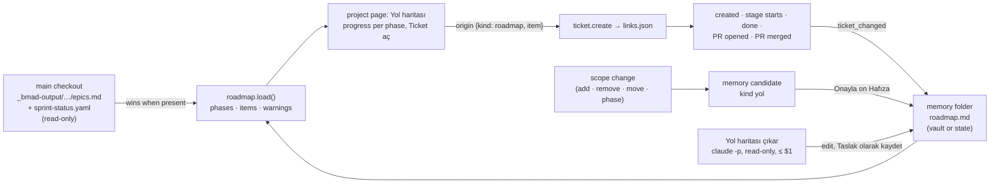

`roadmap.load(target)` reads the roadmap again on every use: BMad's `epics.md` (phases
`## Epic N: …` as `E<n>`, items `### Story N.M: …` with the story key `N-M` as id) and the
`development_status:` mapping of `sprint-status.yaml` (read by hand, no YAML library; backlog and
ready-for-dev → todo, in-progress, review, done; an unknown value is todo with a warning) when the
main checkout has them; else `roadmap.md` in the memory folder (`## P1 · title`, optional
`- Durum: aktif|bitti`, `- [ ] R-3 · title`, an indented `- Ticket: … · PR: … · Durum: …` line
and indented notes). The parser is tolerant like memory.py's; what it cannot read is a warning on
the project page, on "Hafıza" and in the inbox's memory row, never an error. Item statuses are
todo, ticket, in-progress, review (the ticket is done), pr, merged and done (checked by hand).

Progress needs no approval. `ticket.create` with `origin = {kind: "roadmap", item, phase}`
records the link in `<state>/<target>/roadmap/links.json` (`ziggy roadmap link` does the same for
an existing ticket); the ticket's life calls `roadmap.ticket_changed` when it is created, when a
stage starts, when the run ends done, when its PR is opened (`publish`) and when the PR sync sees
it merged (`cleanup.sync`). That rewrites only the item's `Ticket · PR · Durum` line (and `[x]`
once merged), never moves a status back, marks a phase `bitti` when all its items are merged or
done and the first unfinished phase `aktif` when none is; `modified:` in the frontmatter follows.
A BMad roadmap is never written: the linked ticket's status shows over the sprint status.
`roadmap.next_items(target, n)` gives the first items of the active (else first unfinished)
phase that have not started, in order.

Scope changes are memory candidates of kind `yol` (`roadmap.propose`; fields `İşlem` ekle,
çıkar, taşı or evre ekle, `Evre`, `Madde`, `Başlık`, `Ayrıntı`, `Neden`). They wait on "Hafıza"
with the other candidates; approving one runs `roadmap.apply_change` under the memory lock (a
new item gets the next `R-<n>`, a new phase the next `P<n>`), and a BMad target refuses it.

The draft: "Yol haritası çıkar" starts `ziggy roadmap draft` as a background job
(`<state>/<target>/roadmap/jobs/`). One session through dispatch, cwd the main checkout, the
target's `roadmap_model` (default sonnet), at most $1 and 15 minutes, no edit, shell, subagent or
web tools and no credential files, gets the repository's README, `docs/PROJECT.md` and spec
files to read and the memory's `context.md` and active decisions, and answers with the
`roadmap` schema (phases with a goal and items with a detail; not a stage's schema). The record
(`roadmap/drafts/NN-roadmap/run.json`, stage `roadmap` in the stats) keeps the draft as
markdown; the panel shows it in an editor and "Taslak olarak kaydet" writes `roadmap.md`, only
when the target has no roadmap yet.

## Intent gaps

An implement or review stage that finds the change answers a different intent than the ticket and
PLAN (or rests on a PLAN assumption the code proved wrong) ends `NEEDS_USER` with `intentGap`
(summary, evidence, questions) instead of patching around it; `prompts/_intent-gap.md` says what is
not one (bugs, tests, style, the right intent done badly). The engine then:

1. saves what was built since `run.pre_implement` (the commit before the run's first implement) as
   `runs/<id>/attempts/attempt-<n>.patch` (applies with `git apply`) and `attempt-<n>.json`,
   stashes uncommitted edits, and resets the branch there with `git reset --keep`;
2. does not reset a published branch (a PR opened or adopted, a recorded push), a branch whose
   pre-implement commit left its history, a slice another slice is built on, or one with nothing
   built; the round's `intent_gap.kept` says why;
3. opens a question round with the gap's questions (`askThen` is ignored); the answers continue at
   `[intent_gap] then` (default: the first implement stage; `bmad`: bmad-build), whose prompt points
   at the patch copy under `inbox/attempts/`.

The panel's question card shows "Niyet sapması" with the summary, the evidence, the patch and
whether the branch was reset. A pipeline without an implement stage treats it as an ordinary
question round.

## Protected files

The files the agents may not write are the `Edit(./…)` denies of `claude-settings.json`
(`ziggy/protected.py` reads them: `AGENTS.md`, `.claude/settings.json`). Every stage prompt says so
(`_context.md`): a plan never edits one directly; it plans "prepare a patch for <file>", and the
implement stage writes a unified diff (repository-relative paths, `git apply`-able on the branch
HEAD) under `inbox/artifacts/` and lists it in `protectedPatches` (`implement` and `generic`
results; the BMad prompts carry the same rule).

1. After the session the engine validates each listing: the file exists in the inbox, its diff
   headers name only protected files, and `git apply --check` passes in the worktree. Invalid ones
   become result warnings. An implement that returned `FAILED` naming a protected file in its
   summary or open items, with a valid protected-only patch among its `artifacts` (the shape of the
   runs before this existed), is read as `READY` with that patch and a warning.
2. Each valid patch is copied to `runs/<id>/protected/<n>.patch` and recorded in `state.json`
   `protected_patches` (`n`, `files`, `summary`, `stage`, `created_at`, `base_head` = the
   worktree HEAD at the stage's end, where it was validated; status `pending`); an identical patch
   still pending is not recorded twice. Every older pending patch of the ticket touching one of the
   same files becomes `superseded` (`superseded_by: n`): only the newest one per file is a card.
   The run goes on: checks, review, done.
3. The review prompt lists the pending patches; a finding that a protected file still needs a
   change is dismissed with the patch's number instead of sent back as `fix`.
4. Once the ticket stops, the inbox shows `protected` ("Korumalı dosya değişikliği: AGENTS.md")
   with the diff. **Uygula** (`ziggy protected <id> apply <n>`) takes the ticket's lock (refused
   while a stage runs), refuses a dirty worktree, runs `git apply --check` again on the current
   HEAD, applies it and commits `docs(<id>): apply approved change to AGENTS.md` with
   `--no-verify`, like the records commits; the entry becomes `applied` with the commit's `sha`.
   A published ticket then shows "PR'ı güncelle". **Reddet** marks it `rejected` with an optional
   reason.
5. A patch prepared without an earlier one you applied (the next implement revised the same
   section from the file as it was, before you clicked Uygula on the first) no longer applies on
   HEAD. When every commit since its `base_head` that touched its files is one of the ticket's
   applied patch commits, Uygula writes the patch's own result (the files at `base_head` with the
   patch applied, built in a temporary index) over them and commits `… to AGENTS.md (supersedes
   #1)`; the earlier entries get `superseded_by`, and the card says "önceki #1'in yerini alır".
   Any other commit to those files since refuses it ("AGENTS.md bu yama hazırlandıktan sonra
   başka bir değişiklikle değişti; yama uygulanamıyor. Reddet ve ajanın yeni bir yama
   hazırlamasını iste.") and nothing changes. Patches recorded before `base_head` existed take
   the stage's `run.json` `head_after`, or else the parent of the ticket's first applied commit of
   the same file.

Publishing does not wait: the PR form warns "Onay bekleyen korumalı dosya değişikliği var".

## Dependencies and stacked slices

A ticket can start after other tickets of the same target: `new --after <id>` (repeatable), the
composer's "Sonra başla", or `after <id> [ids]` before it runs (no ids clears them). Before every
stage the engine checks them; with one not done the ticket is `waiting` (`waiting_for`, the step
kept in `next`), and when the last one is done it is started as a detached `run` job, by the engine
as that ticket finishes and by the panel's 60 s tick. A dependency that failed, was archived
without being done, or whose PR was closed unmerged leaves it waiting and raises an inbox item
("Bekliyor ama local-3 başarısız oldu").

At the approval gate, a `feat`, `fix` or `chore` plan rated large or high risk whose `## Plan` has
two or more `### S<n>: <title>` slices can be split (`split <id>`, "Dilimlere böl (N PR)") instead
of approved as one PR:

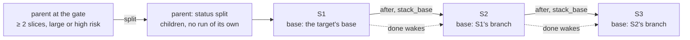

- Each slice is a ticket running the `slice` pipeline (implement → review) on a plan seeded from
  the parent's; the first one starts at once (`--no-run`: none).
- Publishing a slice publishes the unpublished slices below it first; each PR's base is the branch
  below, and every PR body lists the stack.
- When a lower PR is merged, the PR sync moves the next PR's base to the merged PR's base. After a
  squash or rebase merge the next branch still holds copies of the merged commits, so it is marked
  for a restack: `restack <id>` ("Yeniden düzenle") runs `git rebase --onto` in its worktree
  (a conflict aborts and leaves the branch as it was), and only `restack <id> --push` ("Düzenlenen
  dalı push et") pushes it, force-with-lease on the last pushed commit.
- The board's "Sırada" group holds waiting tickets ("Bekliyor: local-3 bitince") and split tickets
  with their slices.

## Usage limits

Each Claude login (a target's resolved `CLAUDE_CONFIG_DIR`, else `default`) has a 5-hour and a weekly
window. Every session's stream carries `rate_limit_event`s (status `allowed`, `allowed_warning` or
`rejected`, the window that decided it with its reset time, each window's utilization);
`dispatch.run` tails them while the session runs (chat turns after they end) and `quota.record`
keeps the latest per login in `quota.json`.

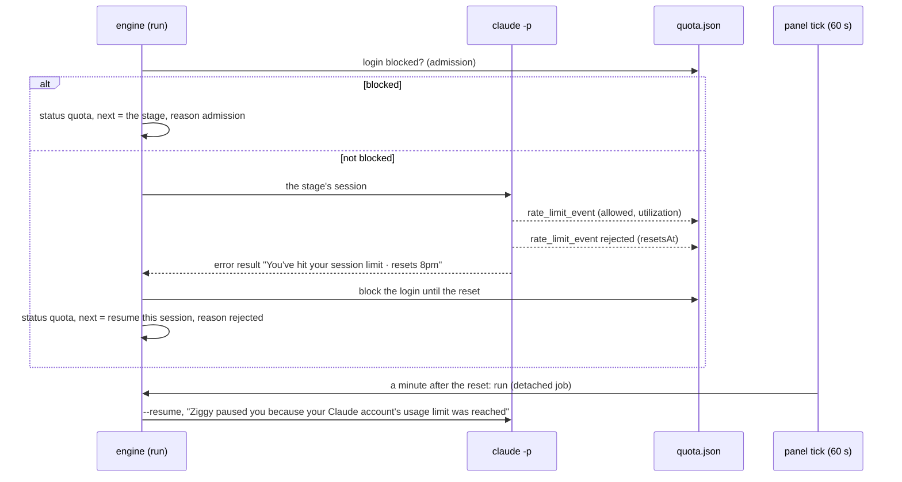

- A session counts as rejected when it wrote no result and its last event was `rejected`, or it
  ended in error (`is_error`, HTTP 429 or a `rate_limit` turn error) with a usage-limit message
  (`quota.USAGE_TEXT`, tolerant); the message is kept as `quota_error` in its `run.json` and its
  reset time read from it when the stream had none (`…|<epoch>`, `resets 8pm (Europe/Istanbul)`).
  Unknown: 30 minutes.
- The stage does not fail and the visit is not counted: the session ends `quota`, its edits stay in
  the tree, and `resume_at` is the reset plus 60 s. The panel's attention tick (`quota.wake`) starts
  the ticket then as a `run` job, also on its first tick after a restart; it starts it earlier only
  when a newer session of the login reports `allowed` (the block cleared).
- An `allowed` event clears a block only when it reports a new window or comes from a session that
  started after the block: a request already in flight says nothing about the limit.
- Admission: before any stage, a blocked login holds the ticket the same way; other logins' tickets
  run on. `run --now` (the panel's "Şimdi başlat", after a warning) skips the check for the first
  stage.
- The inbox has one row per blocked login ("Kota doldu: <hesap> · HH:MM", under the first target
  that uses it), resolved by the first reconcile after the reset. The sidebar's "Kota" lists each
  login's windows (orange from 80 %, red while blocked) and `ziggy status` prints them.

## A busy machine

A Mac that swaps hard turns a `cat` into minutes: a stage started then spends its timeout waiting
for its tools. `host.sample()` reads `sysctl -n kern.memorystatus_vm_pressure_level vm.swapusage`
(pressure 1/2/4 → `normal`/`warn`/`critical`, swap used and total) and the load average, cached
5 s, `unknown` when sysctl fails; it never raises.

- Admission (`pipeline._host_hold`, after the quota check, before every stage): while the pressure
  is `critical`, or `warn` with swap used at `[host] swap_hold` (0.9) of its total or more, the stage does not
  start. The ticket waits as `host` with the stage in `next` ("Makine bellekte zorlanıyor ·
  bekliyor" on its card, row and page). A running stage is never stopped for it.
- The panel's attention tick (`host.wake`) counts calm ticks; a busy one starts the count over. From
  the second calm tick in a row it starts one held ticket per tick, the longest held first, as a
  `run` job, which goes through admission again.
- `run --now` (the panel's "Şimdi başlat", after a warning) starts it anyway, and its later stages
  too, printing a warning each time the machine is busy.
- The health line shows "Bellek: kritik · swap %96" while the pressure is `warn` or `critical` or
  swap is 75 % full (red while it holds stages); `ziggy status` prints a `# host` line. Each stage's
  `run.json` keeps `host` samples: the start, the end and the worst seen (one look every 30 s).
- `[host] enabled = false` turns the hold off (the chip and the line stay).

## Controlled mode

`mode = "controlled"` (for company repositories; `target add` proposes it where `onboard.company`
is true) makes a target fully user-driven; `personal`, the default, keeps everything as above.

- New tickets default to the `bmad` pipeline when BMad is installed and ready on the target
  (`ticket.default_choice`: `new` without `--pipeline`, the composer's default), else the standard one.
- `ticket.create` sets `plan_checkpoint` on every ticket, whatever made it, and `_drive` gates on it
  for tickets made before the switch too. The `slice` pipeline has no gate: its plan was approved at
  the parent's.
- `stack.wake` starts nothing: a waiting ticket whose dependencies are done gets an inbox item
  `start` ("local-3 bitti; local-4 başlasın mı?") whose "Başlat" runs it.
- `pr_replies = true` is ignored with a load warning (`Target.warnings`: printed by the CLI as
  `uyarı: …`, a warning chip on the panel).
- The lead's proposals stay proposals: "Başlat" is refused and only "Ticket olarak aç" (the composer, prefilled) is
  offered; the ticket you create from it accepts the proposal ([the lead](#the-lead)).

## The lead

Every morning `ziggy/lead.py` looks at each target and proposes what to work on next.

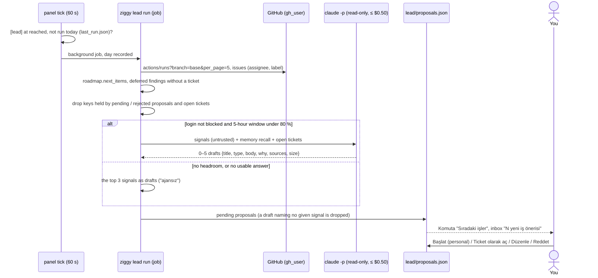

- Signals, each `{key, kind, title, detail, url}`: `ci:<workflow>:<sha>` (the latest completed run of a workflow on the
  base branch failed; the sha is the first commit of the red streak among the runs read), `roadmap:<item>`
  (`roadmap.next_items`: the current phase's first items with no ticket yet), `issue:<n>` (open issues, not
  PRs, assigned to `gh_user` or labelled `lead_issue_label`) and `deferred:<ticket>:<entry>` (deferred findings no
  ticket was made from). GitHub is skipped without `github_repo` and `gh_user`; a failing call is a warning on the run,
  not a failure. Memory entries, faded pitfalls included, are context for the session, never signals.
- No re-proposing: a key held by a pending or rejected proposal, or by an accepted one whose ticket is still open (not
  archived, PR neither merged nor closed), is left out; each signal backs one draft at most. A pending proposal expires
  after 7 days, which frees its keys.
- The session runs like the retro: the same dispatch and sandbox, `lead_model` (default sonnet), at most $0.50 and 10
  minutes, no editing tools, no shell, no subagents, in the main checkout, recorded in `<target>/lead/NN-lead/` (stage
  `lead` in the stats). Its answer is the structured output `results.json_schema("lead")`, a schema no pipeline stage
  may name.
- Accepting: "Başlat" (personal only) creates the ticket with `origin = {kind: lead, proposal}` (its ticket.md says where
  it came from) and runs it; a ticket created from the composer with that origin accepts the proposal the same way.
  Each `roadmap:<item>` source is linked to the ticket (`roadmap.link`, links.json), so the item moves with the ticket
  like one made from the item (`roadmap.ticket_changed`: ticket → in-progress → review → pr → merged).
- Schedule: `[lead] at` (local, default 08:30), `enabled`; the panel's tick starts a target's lead once per local day at
  or after that time, so the first tick after a sleep runs a missed one. `ziggy lead run` does the same from the
  terminal, `--now` (and "Yenile") whatever the time. A run at or after `at` counts as the day's.
- Komuta folds "Sıradaki işler" to one line (the count and the lead's last run) until it is opened; the inbox's
  "N yeni iş önerisi" opens it on that project.

## PR feedback

The panel's PR sync (every 180 s; `ziggy sync` by hand) reads each open PR as the target's
`gh_user`: line comments, conversation comments, reviews with a body, and the checks failing on the
PR's head. For a failing Actions check it fetches the job log through the REST API
(`repos/<repo>/actions/jobs/<id>/logs`, since `gh run view --log-failed` printed nothing with some
gh versions), drops timestamps and ANSI codes, and keeps the 200 lines ending at the last
`##[error]`. Bots are skipped unless listed in `pr_feedback_bots`, and so are the pipeline's own
replies. Items land in `runs/<id>/github/feedback.json`, deduplicated by id; one not sent yet
follows GitHub (edited, deleted, green again).

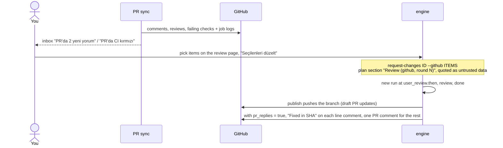

Each sent item records `sent_round`, then `fixed_sha` (and `replied_at`) after the round. A failed
push leaves an inbox reminder; the run stays done.

## Adding a target

"Mevcut repoyu ekle" on the panel (or `target add <path>`) proposes the target's table, and each
prepare line, env value and check carries the file it came from:

| Step | What it does | CLI |
|---|---|---|
| "İncele" | reads the checkout only: lockfiles pick the install (npm, yarn, pnpm, bun, uv, poetry, the shared venv, go, cargo); package scripts and CI `run:` lines become checks with mutating or watch flags removed (or the line dropped with a note); variables the code reads and example env keys get dummy values marked as suggestions | `target add <path>` |
| "Ajanla doldur" | a read-only `claude -p` session (Read, Grep and Glob only; no `.env`/`.npmrc` reads; `[onboard] onboard_model`, default sonnet; at most $1) fills the gaps, then everything is tried; if that fails, one repair session gets the failures and is tried once more | `--agent` |
| "Doğrula" | clones the checkout into the state dir, runs prepare there (network on, a timeout per line) and every check exactly as the engine would (sandbox-exec, the `git status` guard); each line gets a badge ("denendi · 31 sn", "geçmedi: …", "denenmedi"); the clone is deleted | `--verify` |
| "Config'e ekle" | appends the table to the config (a backup is restored if it does not load) | `--yes` |

A git-ignored file the install needs is copied in from the main checkout with `{checkout}` (for
a private registry's `.npmrc`, only for the install, then deleted); `{checkout}` expands in prepare
and env like `{worktree}`. Output shown or logged is scrubbed of token-shaped strings and of the
checkout's real `.env`/`.npmrc` values. A missing `AGENTS.md` comes back as a draft that "Draft PR
aç" commits on `docs/agents-md` in a temporary worktree and opens as a draft PR; for a repository
under a folder with its own gh account or Claude login in `[onboard]`, the panel asks for an
explicit confirmation first.

An Xcode project (`*.xcodeproj` at the root) or a `Package.swift` gets the `xcode` check preset
(`check_sandbox = ["xcode"]`) and, per local package with tracked `Tests/`, `swift test
--disable-sandbox --package-path <pkg> --scratch-path .build/<pkg>`; for the project, `xcodebuild
test -project <x>.xcodeproj -scheme <scheme> -destination 'platform=iOS Simulator,name=<iPhone>'
-derivedDataPath .build/DerivedData -IDEPackageSupportDisableManifestSandbox=YES
-IDEPackageSupportDisablePluginExecutionSandbox=YES 'OTHER_SWIFT_FLAGS=$(inherited) -disable-sandbox' -quiet`
with a 30m timeout. The scheme comes from
`xcodebuild -list -json` (the one named like the project, else the first; the project's name when
that gives nothing), the destination from `xcrun simctl list devices available -j` (on the newest
iOS runtime, the highest-numbered iPhone, the plain model first); without an iPhone simulator the
check is left out with a note. A nested sandbox cannot start inside the checks' sandbox, hence
`--disable-sandbox` and the two `-IDEPackageSupport…` flags (SwiftPM's) and `-disable-sandbox` in
`OTHER_SWIFT_FLAGS` (the compiler's macro plugin server: without it the first `@Model`, `@Query` or
`@Observable` fails the build); `-packageCachePath` and
`-clonedSourcePackagesDirPath` break local packages, so they are not used. `.build/` must be
git-ignored (a readiness line says so). "Doğrula" applies the preset, as the engine does.

"Çıkar" on a project card (or `target remove <name>`) takes the target's tables (`[targets.<name>]` and its sub-tables,
with the comment right above them) out of the config after a backup (`config.toml.bak-<time>`); no other line changes,
and nothing is written unless the result parses to the old config less that target. The repository, its worktrees and
the target's state (tickets, memory) stay, so adding the same repository under the same name brings them back. It is
refused while one of the target's tickets runs, and while `default_target` or a `[sources.*.projects]` mapping names it.

What a removed target leaves in the state dir is listed under "Çıkarılmış projelerin artıkları" on Projeler (`target
leftovers`): its size and its worktrees, which are nearly all of it. "Worktree'leri sil" (`target purge <name>`) removes
those checkouts with `git worktree remove` in the repository they belong to (then `worktree prune`); their branches
stay in the repository, the tickets and memory in the state dir. A worktree with uncommitted changes is refused until
confirmed (`--force`).

## The panel

`ziggy ui` (kept running by launchd with `ui --install`) is a second front end next to
the terminal and the Claude Code skill. It keeps nothing in memory: every request reads the
same `state.json`, `run.json` and `claude.jsonl` files the CLI writes, every button runs the
same command a person would type, and the attention ledger it reconciles is a file the engine
writes too.

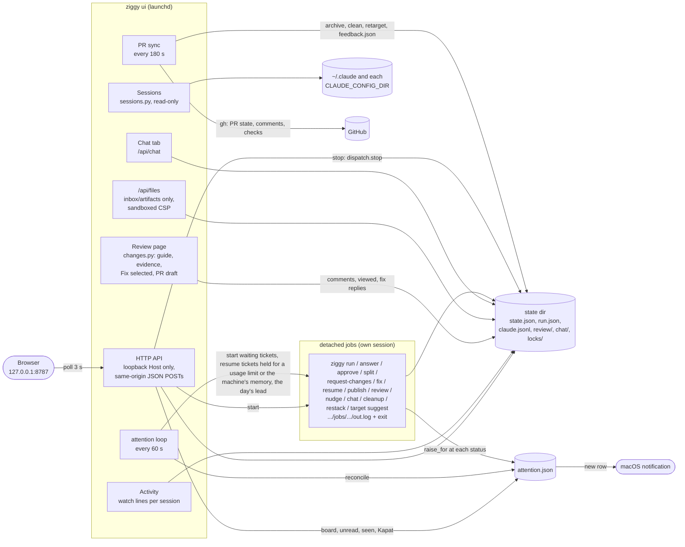

- A job is `sh -c 'ziggy … > out.log; echo $? > exit'` in its own session; launchd's
  `AbandonProcessGroup` keeps it alive when the panel restarts, and the exit file records the
  outcome even if no panel was watching (exit 3: stopped for you).
- Before starting a job the panel refuses what the CLI would refuse anyway, with a readable
  message: a ticket already running, a status the command does not apply to. Busy run slots are
  not refused: the job is started and waits in line.
- The home board has five groups: "Seni bekliyor" (a question round with an answer form, a plan at the approval gate, a
  failed or lost run, a job that exited with an error, PR feedback, a stuck dependency, a slice to restack, a protected
  file's patch with its diff and Uygula / Reddet), "Review'a
  hazır" (done without a PR), "Çalışıyor" (running, quiet, or with a tool call past `stall_after`), "Sırada" (waiting
  for other tickets, for a usage limit or for the machine's memory, split tickets with
  open slices) and "Teslimde" (an open PR, a branch ahead of it, a merged PR whose worktree still holds work).
  "Sıradaki işler" (the lead's proposals) sits right below "Seni bekliyor" ([the lead](#the-lead)). With two projects or
  more, chips above the board (Tümü and one per project, each counting what waits on you there) narrow the board, its
  heading and the proposals to one project; the choice is the browser's, and the composer follows it. Each card
  puts its next step first; j/k and Enter drive it from the keyboard. Items are derived from state
  (`attention.needs`), each with a key for its occurrence; "Kapat" closes a failure, a lost run, a
  job error, PR feedback, a stuck dependency, a restack or a reminder for good
  (`runs/<id>/dismissed.json`), while questions, approvals, protected file patches, quiet sessions and stalled tool
  calls need an action.
- "Gelen kutusu" in the header lists the ledger's rows with the unread count; opening a ticket
  marks its items read. A new row is a macOS notification (`[notifications]`: `enabled`, `events`,
  `min_interval`, 30 s, with the rest summed up; nothing for what is there the first time a target
  is reconciled).
- A running, quiet or stalled ticket has "Yönlendir" (nudge) and "Durdur"; a done or failed one with a worktree
  "Temizle" (`cleanup <id>`, `--force` behind a checkbox). The chat beside the ticket page's tabs ("Ajanla konuş") is the ticket
  chat, and "Sor" on a stage or a question round opens it with a question ready.
- The Stages tab shows per session the visit and its cap (with adjudicated extra visits), effort,
  open findings per class, nudges and retries, and the evidence the stage saved.
- The review page (the ticket page's "Değişiklikler" tab) diffs the ticket's branch (all of it, since a review round, or one commit),
  places the pipeline's own review findings on their lines with class, confidence, verified and
  implement's outcome, lists the unverified candidates, the reviewer's guide and the evidence, and
  keeps your draft line comments in `runs/<id>/review/review.json`. "Seçilenleri düzelt" writes a
  "fix it" reply to each selected finding; "Değişiklik iste" sends the drafts as one
  `## Review (user, round N)` plan section with a fix task per comment and starts a new run at the
  pipeline's `[user_review] then` (implement, or bmad-build). "Onayla → Draft PR" opens an editable
  title and description composed from the implement summary, the guide, the plan's acceptance
  criteria and the evidence, and publishes them word for word (`publish --title --body-file`). A
  ticket with a PR also has "GitHub geri bildirimi" ([PR feedback](#pr-feedback)).
- "Hafıza" shows each target's project memory: candidates to approve, edit or reject, the
  entries with their use counts, faded ones and file warnings ([project memory](#project-memory));
  "Mevcut repoyu ekle" is the onboarding form ([adding a target](#adding-a-target)).
- "Oturumlar" lists the other Claude Code sessions on this machine (live, and ended
  in the last 3 days) with a transcript viewer; the pipeline's own stage and chat sessions are left
  out, and headless helper sessions whose working directory starts with a prefix in
  `[sessions] hide_cwd_prefixes` are only counted.

### MCP server

`ziggy mcp` (`mcp_server.py`) is a third front end: a Model Context Protocol server on stdio that another Claude Code or
Desktop session can use. It is a client of the panel's HTTP API (same loopback Host and JSON-POST rules as the
browser), never of the state files, so the panel stays the only thing that starts jobs and refuses what a ticket's
state does not allow; with the panel down its tools say so. Reads (`ziggy_status`, `ziggy_list_tickets`,
`ziggy_get_ticket`) are free; every write tool needs `confirm: true` in the call, and `--read-only` removes them.

## Choosing the target

`ziggy` uses the configured target whose checkout, or one of whose ticket worktrees,
contains the current directory. Elsewhere it falls back to `default_target`; `--target <name>`
overrides both. `new` prints the target it used.

## Prompts

Stage prompts are Markdown files in `prompts/` written in a Mustache subset
(`ziggy/render.py`): `{{ticket.title}}`, sections, inverted sections, and partials. Every
stage prompt starts with its persona (`{{> role}}`, from `prompts/roles/`) and includes the
standing rules (`{{> _context}}`), the project memory (`{{> _memory}}`, right after it), the
project doc (`{{> _project_doc}}`, except in the `project` pipeline, whose subject it is) and the
ticket (`{{> _ticket}}`, untrusted text and your answers); implement and review also include
`_intent-gap.md`, and review `_review-policy.md`. Review prompts pull in lenses from
`prompts/lenses/` (blind hunter, edge cases, verification gaps, convergence; adversarial for the
doc review). The BMad prompts are the exception: their first line is BMad's slash command, so they
inline their own rules and include `{{> _memory}}` after them. The engine appends the result
protocol (schema, verdicts, the stage's routes) to every prompt, so a prompt only says when to use
each verdict. `prompts/retro.md`, `prompts/roadmap.md`, `prompts/lead.md` and
`prompts/onboard.md` are not stages: they drive the retro, roadmap draft, lead and onboarding sessions. Adding a
pipeline: [pipelines/README.md](../pipelines/README.md).

## Slack (optional, unused)

`ziggy listen` can serve a private Slack channel over Socket Mode with the same flow
(see the README). Intake is the terminal and the panel; the listener stays in the repository but is
not run.
